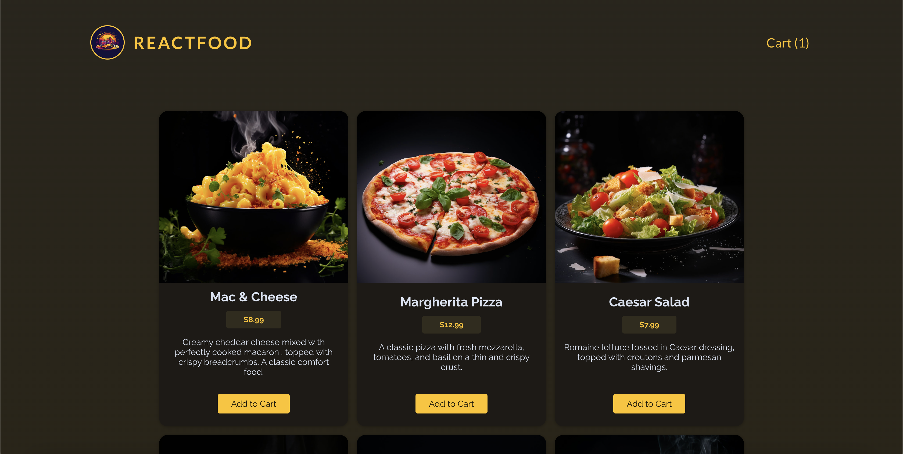
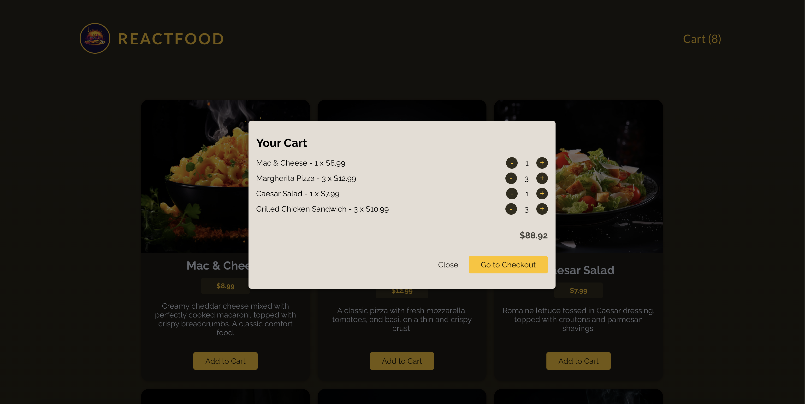
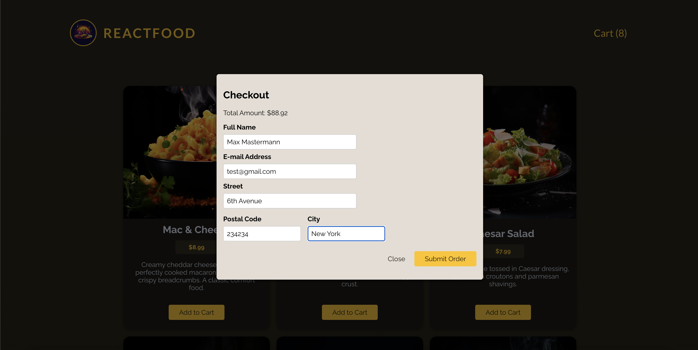

# Food Order App

A small food ordering application with a React frontend and a local Express API. Users can browse meals, manage a cart, and submit customer details with an order.

## Features

- Browse a menu of meals loaded from the backend.
- Add meals to the cart, change quantities, and see the total.
- Submit a checkout form with customer contact and address details.
- See loading, request error, and order success states.
- Persist submitted orders in a local JSON file.

## Technologies

- **Frontend:** React 19, TypeScript, Vite
- **Backend:** Node.js, Express 4, JavaScript (ES modules)
- **Storage:** JSON files (`available-meals.json` and `orders.json`)

The frontend was migrated from JavaScript/JSX to TypeScript/TSX.

## Architecture and Technical Decisions

- The UI is split into page-level components, reusable UI components, contexts, and a custom hook.
- `CartContext` uses `useReducer` for cart updates. The state and discriminated action union cover adding an item, removing an item, and clearing the cart.
- `UserProgressContext` tracks whether the cart or checkout dialog is active.
- Component props are typed, including native button, input, and dialog attributes where useful.
- `useHttp<T>` is a generic hook that manages response data, loading and error state, and exposes request and data-reset functions.
- The API meal model represents `price` as a string, matching the JSON response. `Meals` converts it to a number at the API boundary; the internal `Meal` model and cart use numeric prices.
- Checkout reads named form fields through `FormData` in a React `useActionState` action and sends the order as JSON.
- The frontend `tsconfig.json` enables `strict`, `noUnusedLocals`, `noUnusedParameters`, and `noFallthroughCasesInSwitch`.
- The backend is a small Node.js/Express JavaScript service. It reads meals from and appends orders to local JSON files; it does not use a database.

## What was implemented independently

- Frontend migration to TypeScript/TSX, including typed component props, Context API values, reducer state and actions, and the generic `useHttp` hook.
- Mapping the API meal shape to the frontend model at the point where meals enter the UI.
- Cart state management with a reducer and checkout submission using `FormData` and `useActionState`.
- Frontend integration with the local Express API, including menu loading, order submission, and loading/error handling.

## Project Structure

```text
.
├── backend/
│   ├── app.js
│   ├── data/
│   │   ├── available-meals.json
│   │   └── orders.json
│   └── public/
│       └── images/
├── public/
│   └── logo.jpg
├── src/
│   ├── assets/
│   │   └── logo.jpg
│   ├── components/
│   │   ├── UI/
│   │   ├── Cart.tsx
│   │   ├── CartItem.tsx
│   │   ├── Checkout.tsx
│   │   ├── Error.tsx
│   │   ├── Header.tsx
│   │   ├── MealItem.tsx
│   │   └── Meals.tsx
│   ├── hooks/
│   │   └── useHttp.ts
│   ├── store/
│   │   ├── CartContext.tsx
│   │   └── UserProgressContext.tsx
│   ├── util/
│   │   └── formatting.ts
│   ├── App.tsx
│   ├── index.css
│   └── main.tsx
├── index.html
├── tsconfig.json
├── tsconfig.node.json
└── vite.config.js
```

## Installation and Running

Requires Node.js and npm. Open two terminals from the project root.

1. Install frontend dependencies and start Vite:

   ```bash
   npm install
   npm run dev
   ```

   Vite uses its default development port, `5173`.

2. In the second terminal, install backend dependencies and start the API:

   ```bash
   cd backend
   npm install
   npm start
   ```

   The API listens on port `3000`. Start it before using the frontend, which requests `http://localhost:3000`.


## API

The Express server listens on port `3000` and enables cross-origin requests.

| Method | Endpoint | Purpose |
| --- | --- | --- |
| `GET` | `/meals` | Returns the menu from `backend/data/available-meals.json`. Meal prices are strings in this response. |
| `POST` | `/orders` | Expects `{ "order": { "items": [...], "customer": {...} } }`. Checks that the order has items and customer email, name, street, postal code, and city, then appends it to `backend/data/orders.json` and returns `201`. |

Other routes return `404`. The POST endpoint returns `400` for the validation failures handled by the server.

## npm Scripts

Run these commands from the project root unless noted.

| Command | Description |
| --- | --- |
| `npm run dev` | Start the Vite frontend development server. |
| `npm run build` | Build the frontend with Vite. |
| `npm run preview` | Preview the Vite production build. |
| `npm start` (from `backend/`) | Start the Express API with Node.js. |

## Screenshots

Screenshots are available in `screenshots/`:






